# Boundaries: turn states, who may call what, Pi and MemoryGate, calls back into Pi

One page for four things that were spread over many (A-07). Details stay in the linked pages.

## A turn's states

A turn is one answer to one owner message. Its `status` (table `turns`) is one of these:

```mermaid
stateDiagram-v2
    [*] --> running
    running --> complete: answer saved
    running --> failed: refused or not saved, nothing done
    running --> cancelled: the owner stopped it
    running --> awaiting_approval: a tool needs the owner's yes
    running --> awaiting_budget: ToolGate held it for budget
    running --> action_in_progress: ToolGate is still running an action
    running --> outcome_unknown: an action's result could not be confirmed
    running --> acted_no_reply: acted, then no reply
    running --> interrupted: Pi stopped mid-turn
    awaiting_approval --> running: approved (resumed)
    awaiting_approval --> cancelled: declined, expired or stopped
    awaiting_budget --> running: resumed
    action_in_progress --> running: resumed; ToolGate asked about the same action
    outcome_unknown --> running: resumed; ToolGate asked, never dispatched again
    acted_no_reply --> running: resumed for the reply only
    interrupted --> running: resumed only if it had acted
    complete --> [*]
    failed --> [*]
    cancelled --> [*]
```

| Status | Ends the turn? | What it means |
| --- | --- | --- |
| `running` | no | A model call or an action is under way. |
| `complete` | yes | The answer is saved. |
| `failed` | yes | Nothing was done and no answer was saved; the message is kept to send again. |
| `cancelled` | yes | The owner stopped it, declined its approval, or the approval expired unanswered. |
| `awaiting_approval` | no | Parked on one ToolGate approval request (`approval_request_id`). |
| `awaiting_budget` | no | Parked because ToolGate's spending budget held the action. |
| `action_in_progress` | no | ToolGate recorded the dispatch and has no outcome yet. |
| `outcome_unknown` | no | An action may have run; resuming asks ToolGate about the same action id. |
| `acted_no_reply` | no | The action ran and its result is recorded, but no reply was saved. |
| `interrupted` | yes, unless it acted | Pi stopped mid-turn ([turns.md](turns.md) has every case). |

The `acted` flag is separate from the status: a turn that acted is never reported as one that did
nothing. Only the statuses above that do not end the turn can be resumed (`Loop.resume`,
`pi/turns/replies.py`), and a forgotten chat's turn never resumes. A parked approval that expires
unanswered is ended by Pi's decision sweep (`pi/turns/decision_sweep.py`).

## Who may call what

Pi takes three credentials. Each route names the one it needs, and each check lives in one place
(`pi/api/server.py`, allowlists in `pi/api/browser_contract.py`):

| Credential | Header | Reaches | Check |
| --- | --- | --- | --- |
| Recovery (admin) key | `X-Pi-Key` | every guarded route; for the host CLI and recovery | `require_key`, `require_admin` |
| Gateway runtime key | `X-Pi-Gateway-Key` | only `RUNTIME_ROUTES`: the chat itself | `require_key` + `runtime_allowed` |
| Owner-control key | `X-Pi-Owner-Key` | only `OWNER_ROUTES` (and owner downloads) | `require_owner` + `owner_allowed` |

The browser never holds any of them: the gateway signs the owner in and sends the runtime or owner
key for him ([browser-auth.md](browser-auth.md)); what needs his password is decided there.
`tests/test_route_authority.py` calls every documented operation with each key wherever its
allowlist says no, and expects a refusal, so a new route cannot be reachable by accident.

## Pi and MemoryGate

- **Pi keeps the words.** Transcripts live only in Pi (ADR-0002). MemoryGate gets derived
  evidence: the owner's own messages, quoted, under their message id.
- **The outbox carries ids, not text.** Each owner message is committed together with an outbox
  entry naming it; a worker delivers it to MemoryGate and retries until MemoryGate acknowledges
  its commit ([memory.md](memory.md)). Assistant replies, tool results and Pi's own words are never
  admitted as the owner's.
- **Reads go the other way.** Before a model call Pi asks MemoryGate for a bounded context package
  with its read key and saves exactly that package against the turn; it is marked untrusted and
  grants nothing.
- **Forgetting crosses it once.** Forgetting a chat turns its outbox entries into deletions in the
  same transaction, and what Conker kept in MemoryGate on its own is forgotten there once Pi runs
  again ([forgetting.md](forgetting.md)).

## Calls back into Pi (the service loop)

Pi calls ToolGate and MemoryGate, and both call Pi back for model text (`POST /inference`,
[inference.md](inference.md)). So the service graph has two cycles. They exist so the owner picks
every model in one place (Settings, Models). Line numbers are as of this page's commit.

**Loop 1, synchronous: Pi turn -> ToolGate -> Pi `/inference`.**

| Step | Code | Wait |
| --- | --- | --- |
| A turn invokes a tool | `pi/turns/loop.py:431` -> `pi/actions/toolgate.py:356` | `PI_TOOLGATE_TIMEOUT_S`, 120 s (`pi/api/startup.py:159`) |
| An `ollama_generate` tool asks Pi for text | `toolgate/api/dispatch.py:183` -> `toolgate/executors/pi_inference.py:44` | 180 s (`pi_inference.py:20`) |
| Pi answers with the `tool-text` role | `pi/api/routes/inference.py:28` -> `pi/models/service_inference.py:288` | role wait x tries (`service_inference.py:315`); 300 s per try until the owner sets one (`pi/models/roles.py:50`) |

Only when `TOOLGATE_PI_URL` and `TOOLGATE_PI_SERVICE_KEY` are set; every Conker layout sets them.
The turn waits in its request thread while ToolGate waits on Pi.

**Loop 2, asynchronous: Pi -> MemoryGate -> Pi `/inference`.** Pi's outbox worker delivers owner
messages (`pi/memory/service.py:182`) and turns read context (`service.py:229`). Neither waits on a
model. In MemoryGate (paths under `services/api/app/`) its own worker analyses evidence later
(`services/processing_worker.py:133`) and asks Pi's `memory-sorting` role
(`services/ollama_service.py:25` -> `services/pi_inference.py:75`, 90 s). Its `POST /runtime/ask`
also asks Pi (`routes/runtime.py:320`), but no Pi path calls it, and ToolGate refuses every
`memorygate` tool with `operation: ask` (`toolgate/api/invocation.py:402`).

**What stops recursion.** `/inference` is a leaf: it calls a model provider only, with no tools and
no memory (`pi/models/` never calls ToolGate or MemoryGate), and each service may use only its own
role (`service_inference.py:31`). So the depth is fixed at two hops; nothing can call `/inference`
again from inside it. Each service has at most 4 calls in flight (`service_inference.py:38`); the
fifth is told to try again (503). MemoryGate's calls run in the background lane, which a reply can
preempt (`pi/turns/inference_control.py:166`). The turn holds no local-model slot and no database
transaction while it waits on ToolGate. No service calls another at startup; compose start order
(`depends_on`) has no cycle.

**Health crosses too, and ends.** ToolGate's `/health` probes Pi's `/health`
(`toolgate/api/routes/health.py:118`); Pi's `/health` asks ToolGate `GET /v2/agent/status`
(`pi/api/server.py:388`), which calls nothing. Pi caches its result for 5 s, ToolGate for 15 s.

**Known risks.**
- The waits shrink inward: Pi gives up on ToolGate at 120 s, ToolGate on Pi at 180 s, Pi's model
  call may run 300 s or more. When the turn gives up it parks as `outcome_unknown` (it does not
  hang, and resuming asks ToolGate about the same action). ToolGate records its own Pi failure as
  an unknown outcome too. Pi's `/inference` does not notice that its caller left: it keeps the
  model, and on a local model the one local slot, busy until the role's wait ends.
- A turn and `/inference` share Pi's request threads (one process, Starlette's default pool of
  40). If every thread held a turn waiting on an AI tool, `/inference` would wait for a thread
  until the 120 s timeout. One owner does not reach that, and the 4-call limit keeps
  `/inference` from filling the pool.
- A slow model makes an AI tool slow: a turn that calls one can wait up to 120 s.
